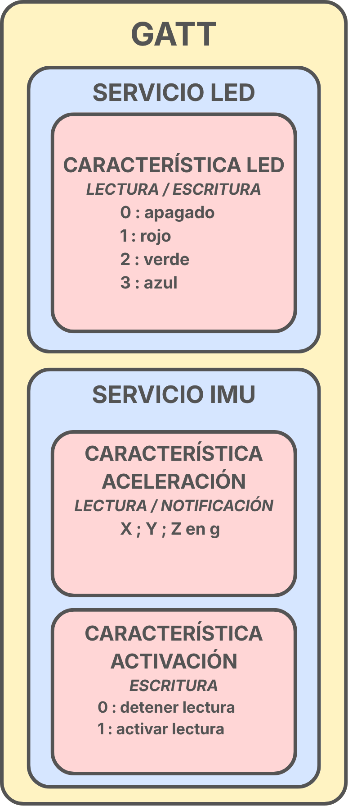
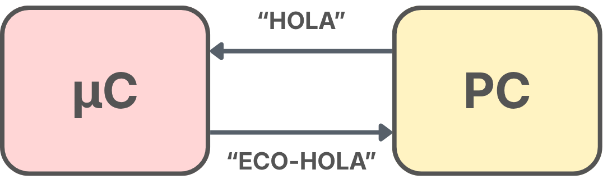

# P4 · Comunicaciones Bluetooth

Práctica de comunicación inalámbrica con <strong>Bluetooth Low Energy (BLE)</strong> en Arduino Nano 33 BLE y <strong>Bluetooth Classic</strong> en ESP32. Se trabaja el descubrimiento de dispositivos, el acceso a datos mediante GATT y el intercambio de mensajes mediante un puerto serie Bluetooth.

Los proyectos utilizan PlatformIO y el framework Arduino. La carpeta <code>hal</code> reúne el acceso al hardware y la gestión de Bluetooth; <code>network</code> define y gestiona el GATT, y <code>protocol</code> contiene el comportamiento del eco en el ESP32.

## 1. Advertising BLE

Proyecto: [P4_01_ADVERSITING_NOMBRE](P4_01_ADVERSITING_NOMBRE).

El <em>advertising</em> permite que un dispositivo BLE anuncie su presencia antes de establecer una conexión. El Nano se identifica como <code>Nano-DIEGO</code> y anuncia un servicio con el UUID <code>44494547-4F00-0000-0000-000000000000</code>, cuyos primeros bytes representan «DIEGO» en ASCII. El nombre visible y el UUID son campos distintos: el identificativo solicitado está incluido en el UUID.

<code>initBLEAdvertising()</code> configura e inicia el anuncio. En el bucle principal, <code>updateBLE()</code> llama a <code>BLE.poll()</code> para atender los eventos de comunicación. El dispositivo puede descubrirse desde nRF Connect.

## 2. GATT: LED RGB y acelerómetro

Proyecto: [P4_02_GATT](P4_02_GATT). Incluye las tareas 2, 3 y 4 del guion.

El Nano actúa como <strong>periférico y servidor GATT</strong>, y el móvil accede a sus datos como cliente. Un servicio agrupa características relacionadas; cada característica contiene un valor y establece las operaciones permitidas. Los servicios y las características tienen sus propios UUID, y los descriptores añaden información sobre el significado de los datos.

  

El diagrama muestra los dos servicios y sus tres características. El servicio LED permite consultar y modificar el color. En el servicio IMU, la aceleración se publica como texto <code>x;y;z</code>, en <strong>g</strong>, con permisos de <strong>lectura y notificación</strong>. Al suscribirse, el cliente recibe las nuevas medidas sin tener que solicitarlas una a una. La característica de activación es <strong>solo de escritura</strong>: <code>0</code> detiene las lecturas y <code>1</code> las reanuda; no corta la alimentación del sensor.

<code>initGATT()</code> registra los servicios, características y descriptores. Durante la ejecución, <code>updateGATT()</code> aplica las órdenes de color y activación, y actualiza la aceleración cuando hay una medida nueva y las lecturas están habilitadas.

**Conexión del móvil al Nano 33 BLE mediante nRF Connect**

https://github.com/user-attachments/assets/273c994d-3270-49c2-8eca-0aa6892530ba

**Lectura del acelerómetro y escritura del color del LED**

https://github.com/user-attachments/assets/cd78442c-7eb3-4d31-be75-4a8e5c907a2e

## 3. Bluetooth Classic: eco de mensajes por SPP

Proyecto: [P4_03_BLUETOOTH_CLASSIC](P4_03_BLUETOOTH_CLASSIC).

El ESP32 utiliza <code>BluetoothSerial</code> y el perfil <strong>SPP (Serial Port Profile)</strong> para intercambiar texto como por un puerto serie. Se identifica como <code>ESP32-Chat</code>. En esta implementación, la comunicación se realiza con un terminal del PC a través del puerto serie Bluetooth.

  

El diagrama representa la respuesta automática del ESP32: el PC envía <code>HOLA</code> y recibe <code>ECO-HOLA</code>. <code>leerBluetooth()</code> acumula los caracteres entre llamadas y devuelve el mensaje cuando llega un retorno de carro o salto de línea. Mientras el mensaje está incompleto, devuelve una cadena vacía sin quedarse esperando. <code>eco_mensaje()</code> añade el prefijo <code>ECO-</code> a cada mensaje no vacío y lo envía mediante <code>escribirBluetooth()</code>.

## Uso

Abrir la carpeta de cada proyecto en PlatformIO y cargarlo en su placa correspondiente. Para BLE, conectar con <code>Nano-DIEGO</code> desde nRF Connect, explorar sus servicios y activar las notificaciones de aceleración. Para SPP, emparejar <code>ESP32-Chat</code> con el PC, abrir su puerto serie Bluetooth y enviar mensajes terminados en CR o LF.

